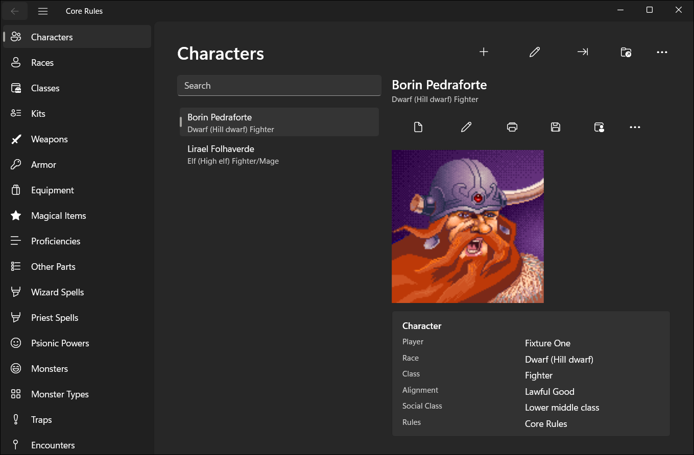
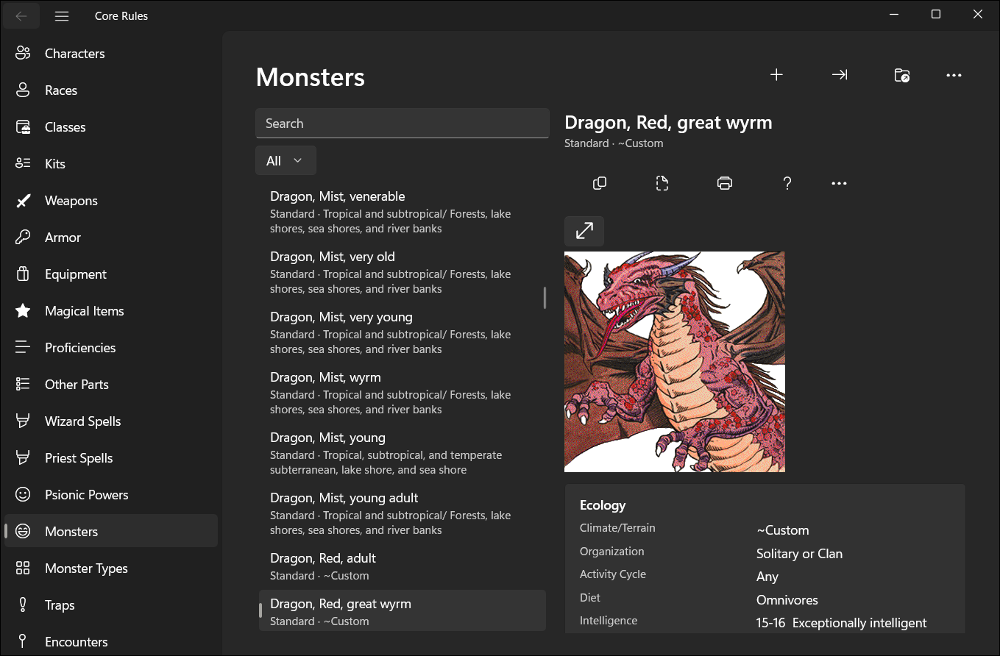
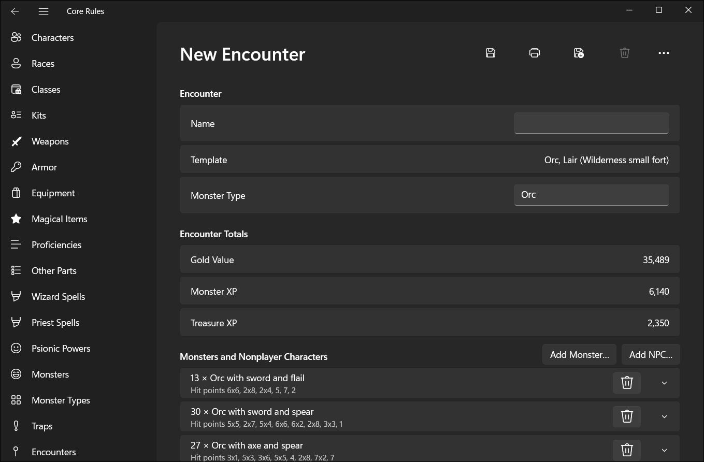
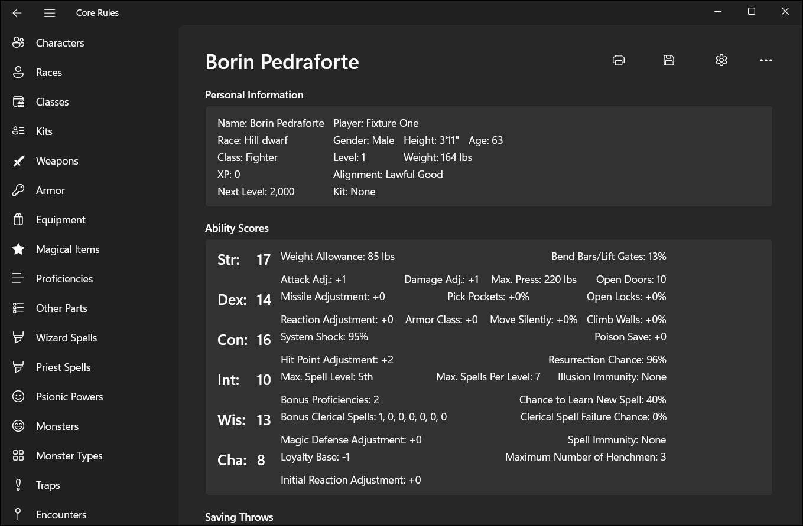
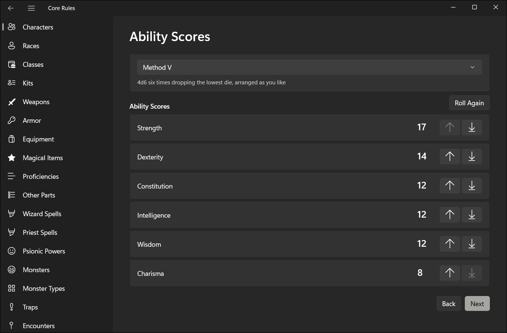
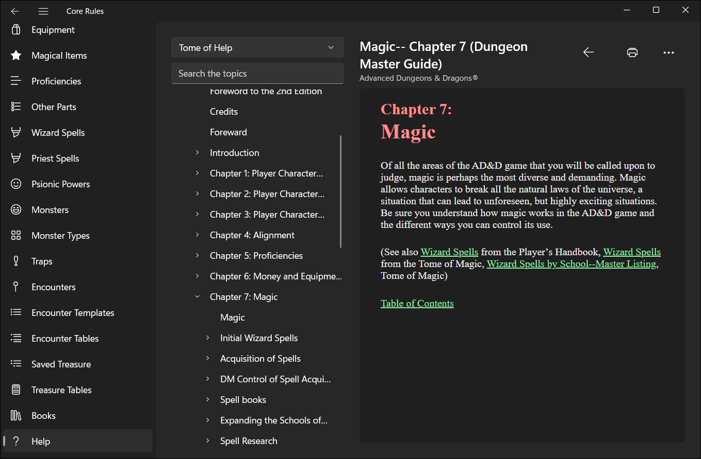
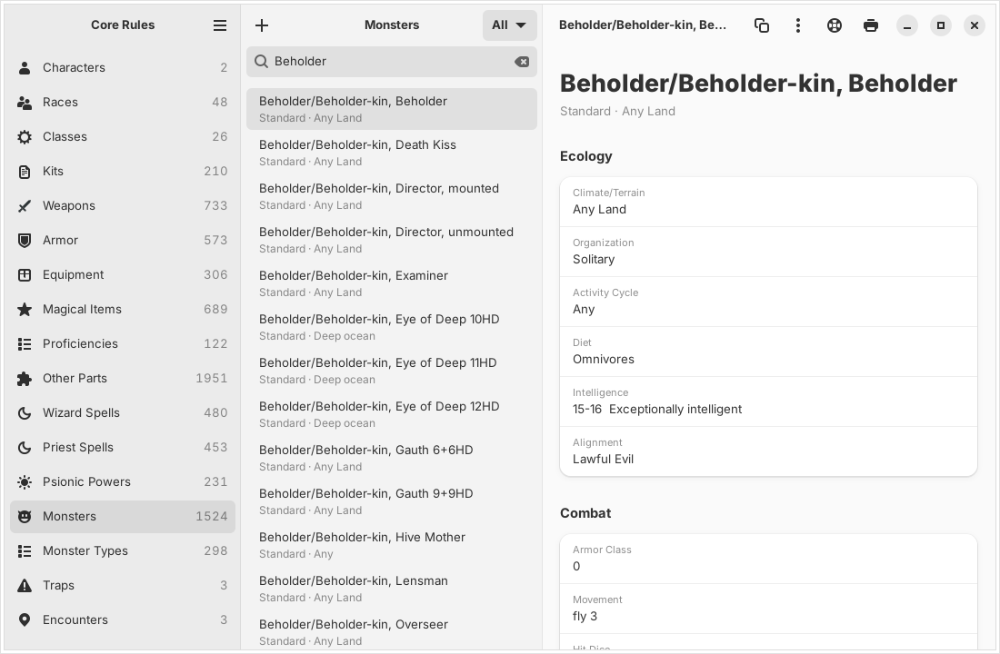

<p align="center">
  
</p>

# Core Rules

**Core Rules** is a complete Linux and Windows 11 version of **AD&D Core
Rules 2.0** and its **Expansion** (TSR/Evermore, 1998-1999), the character
manager and Dungeon Master's toolkit for Advanced Dungeons & Dragons 2nd
Edition. It is written in Rust and runs natively: with GTK 4 and libadwaita
on Linux, with no Wine, and with WinUI 3 on Windows 11. On Linux it comes as
a `.deb` for Ubuntu, an `.rpm` for Fedora, a pacman package for Arch Linux
(and CachyOS and Omarchy), a Flatpak and an AppImage; on Windows 11 it comes
from the Microsoft Store, where it is in a closed beta. See
[Installing](#installing).

Every screen of the original program is here: the Character Generator with
Create, Enter and Update Character, kits and Player's Option, the character
sheet, parties, the NPC, treasure and encounter generators, Table Rolls,
editors for every user database, DM Toolkit packages, the rule books and
the help. The app reads and writes the original's own data files, so
characters, monsters, encounters and packages made in either program open
in the other.

> **Version 1.0.0, the first stable release.** Every feature was checked
> against the original programs and went through a full round of manual
> tests, and players and Dungeon Masters ran the release candidate on
> Fedora 45 beta, Ubuntu 26.10, Bazzite, Arch Linux and CachyOS, where it
> worked as it should. [Download it](#installing) for your distribution,
> or visit the [website](https://brahm.github.io/corerules/).


### On Windows 11

The Windows 11 version has every screen of the Linux one, over the same
backend and the same data files, with the look of a Windows 11 app: the
navigation pane, command bars, settings cards, the system's light, dark
and high-contrast themes and the Mica backdrop. The help files of the
discs open in the app's own Help page, since Windows 11 no longer has a
WinHelp reader.

<p align="center">
  
  
</p>
<p align="center">
  
  
</p>
<p align="center">
  
  
</p>

## You need the original discs

This project contains no TSR or Wizards of the Coast content. The rules,
books, monsters, pictures and help all come from a copy of AD&D Core Rules
2.0 (and, for everything the app creates and edits, the Expansion) that you
already own. The app copies what it needs from the CD, its ISO image or an
installation once, and then works without them (see
[Getting the rules data](#getting-the-rules-data)).

If your discs are lost, scratched or unreadable, disc images have been
preserved by the Internet Archive:

- [AD&D Core Rules 2.0](https://archive.org/details/adndcore2rules) (1998)
- [AD&D Core Rules 2.0 Expansion](https://archive.org/details/add-core-rules-2.0-expansion) (1999)

> **Copyright notice.** AD&D Core Rules and its contents are copyrighted
> by Wizards of the Coast, and these images are not covered by this
> project's license. Download an image only if you own the original disc
> it replaces, and keep the data the app extracts for your own use; do not
> redistribute it. This project does not host these files and is not
> responsible for them. The links above are the archive's item pages, where
> you can read about each item before choosing whether to download it.

## Status and roadmap

1. **Release candidates (done).** 1.0.0-rc1 and 1.0.0-rc2 went to real
   users, and the problems they found were fixed.
2. **1.0 (now).** The release candidate was confirmed stable on Fedora 45
   beta, Ubuntu 26.10, Bazzite, Arch Linux and CachyOS, and became 1.0.0:
   a faithful replacement for the original program.
3. **Windows 11 (in beta).** A Windows 11 version in this repository,
   with a native WinUI 3 interface written in Rust over the same backend,
   distributed through the Microsoft Store. Every screen is ported, and a
   closed beta goes through the Store; once its users confirm it, it is
   released with the same version as Linux. From then on every feature
   ships on Linux and Windows together.
4. **New features.** From then on the app improves on the original and
   moves away from it, step by step, until it no longer needs the original
   program's files to work.

The [roadmap](docs/roadmap.md) has the plan, what is done and what each
step needs; the [decision log](docs/decisions.md) records every decision
that shaped the app's scope and behavior.

## Features

Everything the app saves opens in the original programs. Where a feature
says it works as the original does, its results were compared with files
the original programs wrote.

### Library

- Browse the characters, races, classes, items, spells, psionic powers and
  monsters of an installation, of its CD, or of a data package
- **Extract Data from CD…** copies what the app uses from the Core Rules
  2.0 or Expansion CD (its ISO image or the mounted CD) or an installation
  into the app's data folder, so neither the CD nor Wine is needed again
- Weapons, armor, equipment and magical items show their icons, those of
  `Bitmaps/Equip` or the user's own in `UserBMP`, on their pages and in a
  character's equipment
- The Core Rules books in a reader with contents and search
- Lists sort exactly as Windows sorts them (`CompareStringW`, checked under
  Wine)

### Character Generator

- **New Character** (Ctrl+N), following the original wizard: campaign
  setting, ability rolls (Methods I to VI, entered scores or Player's
  Choice), race and subrace (with the original's question for the point a
  race such as the Mongrelman adds to an ability of the player's choice),
  class, details (with a name from the NPC generator for the subrace,
  given when the character has none and again from the button beside the
  name, and the Background… dialog's event, with Select Randomly, and
  history), proficiencies and languages,
  rogue skill points, psionics for a psionicist (disciplines, powers and
  modes, with the 1st-level PSPs rolled), spells (each learned as the original learns it:
  the chance to learn rolled, and a question before passing over a limit
  of level, Intelligence, spells per level or barred school), wild talents
  for a character who is not a psionicist (with the Expansion: Test for Wild
  Talents, and one roll on Table 83 for a wild talent) and starting
  equipment. The original has no campaign settings, so each setting only narrows what the installed
  databases offer, following its campaign book. Once the rules are chosen,
  the Expansion's "Core Rules Vs Player's Option" message says which kind
  of character is being made, until "Do not show this window again" is
  ticked; Preferences turns it back on, as the original's User Options do
- **Enter Character**, the same wizard for a character that already exists
  on paper, as the original's Enter Character button: scores typed in from
  1 to 25 and kept as typed, exceptional Strength at 18 whatever the class,
  any race and its classes with no minimums, All Classes… for any other
  combination (one class of each group), a free alignment and gender, and
  on the details page each class's level or experience in the Levels
  dialog (prime requisite bonus, level limits, character points per level),
  rolling hit points and PSPs for each level gained, with hit point and PSP
  arrows in place of the rolls. The later pages take what the sheet has:
  racial and class abilities, proficiencies, rogue points and spells of any
  level with no limits or totals checked, wild talents rolled as often as
  wanted or chosen from the list, the kit's equipment not imposed
- **Kits** in New Character, as the Expansion offers them: only those the
  character's scores, gender, alignment and classes allow, with the
  original's warnings and the kit's information text. The kit's fixed rogue
  skill adjustments, barred class abilities, schools, spells and languages
  are applied when the character is written, and again when an edit is saved.
  The kit's own rogue skill points, its bonus to one skill of a list, the
  skills it has the character choose and its list for the starting points
  (with the original's warning) are on the Rogue Skills page. The schools
  the kit bars are warned about on the Spells page and go unless ignored,
  and a kit limited to five schools has the wizard eliminate the rest, the
  spells offered following the schools kept. The kit's hit points go on
  every hit die roll and its own dice and percentages on the starting
  money. The Equipment page shows the kit's text, the items and the chosen
  weapon it requires, charges the kit's percentage of each price, gives the
  kit's free equipment, weapons and magic items, and warns when more money
  is kept than the kit allows
- **Items a character may not use**: buying one on the Equipment page of
  New Character or of an edit asks first, with the original's message about
  the class, race, class abilities or kit
- **Class and kit proficiencies** in New Character: the required ones go in
  first, bonus, free and kit-recommended ones cost less or nothing, the
  bonus, free, +1 and +2 picks are offered as the Expansion offers them, the
  kit's own starting slots are asked about, and a proficiency the kit bars
  brings the original's warning
- **Kit weapon proficiencies** in New Character: the kit's slots, prices
  and weapon list, the original's warnings for the weapons it bars or
  requires (its sword list, thrown weapons, every other one from a list),
  the nonweapon slots it lets weapons use, its requirements, the weapon to
  focus in, and Core Rules weapon specialization (2 slots for a bow, 1 for
  the others, a free one some kits give) with the original's questions;
  weapons out of class ask first (Core Rules) or cost more (Player's
  Option), as do a cleric's edged weapons and the class abilities that
  limit weapons, and unarmed combat goes to the classes and kits that
  allow it, never together with a weapon specialization
- **Player's Option** (Skills & Powers) creation, as the Expansion's
  Player's Option button: Methods VII to X, racial and class abilities
  bought with character points, subabilities, traits and disadvantages,
  proficiencies with ranks, broad and tight weapon groups (warriors and
  priests, 6 and 4 points, covering their weapons for the kit's checks,
  the specializations and the attack penalty), weapon of choice, expertise
  and specialization, unarmed combat, shield and armor proficiencies,
  fighting styles
- **Portraits**, in New Character and when editing: one of the race's
  portraits or any other in `Bitmaps/Portrait`, or a BMP, JPEG, GIF or PNG
  picture of your own, which the app cuts to the portraits' size and saves
  there as an 8-bit bitmap in the original's palette, so the original shows
  it too
- **Editing** a character: name, player, gender, alignment, kit (which
  rolls the social class again, as Update Character does), social class,
  background event (with Select Randomly, which picks one of the 20 events)
  and history, portrait, age, height, weight, hit points
  (moving the rolls as the original's arrows do), ability scores, subrace,
  racial and class abilities, schools and spheres, weapon proficiencies,
  weapon groups, weapon of choice, expertise, specializations, mastery, unarmed combat,
  shields, armor, fighting styles, traits and disadvantages (charging and
  refunding character points as Update Character does, with its questions
  and the kit's weapon warnings, the Core Rules slots left, the kit's free
  weapons at their levels, the kit's focus weapon, and the Cavalier's sword
  at 3rd level and horseman's weapon at 5th), rogue skill points
  at the current level (with the kit's own points, its bonus of each level
  and the skills it has the character choose, none of them spent), psionic disciplines and powers, wild talents (with
  the original's Test for Wild Talents, its risks and saving throws, and Roll
  for Wild Talents on Table 83) and psionic attack and defense modes (with Update Character's limits), nonweapon
  proficiencies (ranks, costs as New Character charges them, the kit's free
  ones at their levels, the Core Rules slots left, and the kit's warnings
  and questions), languages, spells known (learned with New Character's
  roll and questions), spellbooks and memorized spells
  (with the kit's barred schools, the schools beyond five to eliminate, the
  spheres to keep, its free sphere and its warning for a kit that never
  uses spells, as Update Character's Spells and Memorize pages ask, and
  the kit's notes on the schools and spheres of the Abilities page), the
  nine equipment groups with quantities (with the kit's text, and the
  original's question about an item the character may not use), and
  Spending Money, with the original's Buy and Sell mode: an item added is
  paid for with the spending money at the kit's percentage of its price
  (or refused with the original's messages), and one removed or lessened
  gives its price back
- **Experience and levels** per class, all classes or split, with the prime
  requisite bonus, hit point rolls, PSPs, character points and the
  Expansion's racial level limits, and the kit's own experience per level,
  cap on the bonus and hit points per level; the original's Levels dialog
  (each class's level from 1 to 100, which puts its experience at what the
  level takes, and the unspent character points to adjust), and hit point
  and PSP arrows; **dual-classing** for humans
- **Character sheet**: every section the originals export, shown in the
  app, printed, saved as PDF, or exported as the originals' TXT and HTML,
  matching their exports line for line, or as Markdown (in place of the
  Expansion's RTF); in the Expansion, the sheet's options choose its
  sections, their order and page breaks, and the printed border
- **Parties**: Manage Parties… puts characters in a party, takes them out
  or deletes every member; a character can be deleted, with Undo; the list
  filters by party; in the Expansion, Group Encounter… makes an encounter
  of a party's NPCs, or prints them as one in the original's full or
  condensed format
- **Rebuild the character list**: when `Chars/index.chr` cannot be read, or
  lists a character whose file is missing or damaged, the app offers to
  rebuild it from the character files, as the original does
- **Convert to NPC** and **Convert to Character** move a character to the
  DM Toolkit's NPCs and back, writing the same files as the Expansion

<p>
  
  
</p>

### DM Toolkit

- **NPC generator** (New NPC, New NPC Group): Core Rules and Player's
  Option NPCs with kits, proficiencies, equipment, spells, psionics and
  rogue skills; New NPC Group lists the standard races, the kits and the
  alignments the line allows, as the original's Standard and Allowed
  choices (All Races, All Kits and Any Alignment list every one); with the
  same seed it saves the same NPCs as the Expansion
- **Treasure generator**: treasure types A to Z, table rolls, intelligent
  weapons, spell scrolls, Calculate and saved bundles (opened again or
  copied into a new one); with the same seed
  it saves the same bundles as both originals, byte for byte
- **Encounter generator**: encounters from templates with the originals'
  dice, dependents, items and treasure, the Encounter dialog's editing and
  totals (each monster's hit points set by hand or rolled again with
  Re-roll, New Monster from Add Monster, and View NPC and Print NPC on
  its NPCs' sheets), saved encounters (edited or
  copied into a new one) and the 2-20 tables (each roll's template picked
  from those of one frequency that pass the table's filter, opening on the
  roll's own frequency as the original does); View and Print on monsters,
  encounters, templates, 2-20 tables, saved treasure and treasure tables,
  each as the original's page; monster types, monsters, templates and
  encounters show the type's picture with Next Image (the original's
  Alternate Image(s)) and Full Screen, which shows it to the players in
  the original's frame
- **Table Rolls** on every table of the books, with the originals' dice
  and follow-up rolls
- **Editors for every user database**: races, classes (with the free
  spells, NWPs and class abilities each level grants, and Auto Fill from
  another class; changing a class's group, after asking, or deleting it
  takes it out of every race's combinations) and allowed combinations, parts (weapons, armor, kits and proficiencies, whose lists
  have the original's Magic Only, plus the
  ten other types in Other Parts: racial and class abilities, languages,
  schools, spheres, traits, disadvantages, gems and art, currency and
  Count), spells (with Schools…, which changes only a spell's schools
  and spheres, a standard spell's included, as the original's does),
  psionic powers, monsters (with their spells, their
  inventory in the Treasure Bundle Editor, their attacks, each made or
  changed in the Monster Attack editor the original has but hides, and
  Suggest XP Value), monster
  types, traps, treasure
  tables (each entry with its number found, chance of being intelligent,
  random contents from two tables, what it always contains and, for a
  scroll, its spells) and encounter templates (monsters, NPCs, items with their coins
  and escorts, traps, treasure types and the 2-20 table, with the
  original's dependents and "and"/"or" second groups). A monster type's picture is chosen among those in
  `Bitmaps/Monsters` and `UserBMP`, a race's among the portraits, or made
  from a picture of your own as portraits are (monster pictures go to
  `UserBMP`, at 300×300). A weapon's, piece of equipment's, magical item's,
  gem's or coin's picture, on General Info, is one of the icons of
  `Bitmaps/Equip`, found by the items that have it, one of yours in
  `UserBMP`, or made from a picture of your own (64×64, in `UserBMP`)
- **Packages**: Export, Import, New Package and Edit Package for `.xpx`
  packages with characters and any user record, byte for byte as the
  Expansion writes them; Core Rules 2.0 `.xpt` packages are imported and
  converted. Monsters travel in these packages (there is no `.mon` file).
  An imported part named like a standard one gets a "*", and Name
  Conflict asks for another name when a part has that one too; as in the
  Expansion, opening the folder renames the kits, nonweapon proficiencies,
  schools and magical items of yours that a standard one's name hides

<p>
  
  
</p>

<p>
  
  
</p>

<p>
  
  
</p>

### Core Rules 2.0 and the Expansion

Everything new follows the Expansion (AD&D Core Rules 2.0 Expansion). A Core
Rules 2.0 installation without the Expansion opens read-only: Import Core
Rules 2.0… (or `cr import EXPANSION_DIR CORE_RULES_2.0_DIR`) copies its
characters and records into an Expansion installation, converted the way the
Expansion converts a 2.0 package, and leaves the 2.0 folder untouched.

### Everywhere

- Interface in English (US), Português (Brasil), Español, Italiano,
  Français and Deutsch (see [Languages](#languages))
- Runs without Wine from a data package (see
  [Getting the rules data](#getting-the-rules-data))
- The `cr` command does the same from a terminal: `cr chars`, `cr sheet`,
  `cr npc`, `cr treasure`, `cr encounter`, `cr table`, `cr userdb`,
  `cr export`, `cr import`, `cr package`, `cr party`, `cr delete`,
  `cr survey`
- **Help**: the Help button and F1 on every screen open its topic of the
  program help, as the original's Help… buttons do; a right-click on a
  control shows its help, and on a race, class, item, spell, psionic power
  or monster its topic in the book's help (or, for a record of the user
  database, its description), and on a character, trap, encounter,
  template or saved treasure its summary, as the original does; the help
  window and the monster page can print; the Help menu has the
  Online Manual, the Tome of Help (every installed book's help) and About,
  with the original's version, copyright and credits. The installation's
  WinHelp files are read by the app's own help window
- Every file the app reads or writes is specified in
  [`docs/formats`](docs/formats/README.md)

## Differences from the original

The app aims to do what the original does, the way it does it, and saves
nothing the original cannot read. This is the complete list of where it
differs, each one on purpose; the [decision log](docs/decisions.md) says
when and why each was decided.

### Platform and setup

- **Linux and Windows 11, no Wine.** The app is a native GTK 4 program on
  Linux and a native WinUI 3 program on Windows 11, over the same backend.
  Windows 10 and older versions are not supported.
- **No installation of the original needed.** Extract Data from CD… copies
  what the app uses from the CD, its ISO image (read directly, with no
  mounting) or an existing installation into a local data folder. The
  original has to be installed from its CD.
- **Core Rules 2.0 without the Expansion opens read-only.** Everything new
  follows the Expansion. A 2.0 installation's characters and records are
  brought into an Expansion installation with Import Core Rules 2.0…,
  converted the way the Expansion converts a 2.0 package.
- **Six interface languages.** The original is in English only; the app's
  interface is also in Português (Brasil), Español, Italiano, Français and
  Deutsch. Rules texts from the original files stay in English.
- **Preferences in place of User Options.** The only User Options setting
  within scope, turning the "Core Rules Vs Player's Option" message back
  on, is in Preferences, together with the interface language.
- **Its own help window.** The original's WinHelp files are read and shown
  by the app, since Linux has no WinHelp.
- **Campaign settings in New Character.** The original has none. Choosing
  Forgotten Realms, Greyhawk, Dragonlance and the others only narrows the
  races and classes the installed databases offer, following each
  setting's campaign book; Generic offers everything, as the original does.
- **A `cr` command-line tool** does most of what the app does from a
  terminal. The original has nothing like it.

### Features added

- **Character sheet as PDF and Markdown.** Besides printing and the
  original's TXT and HTML exports (identical line for line), the sheet can
  be saved as PDF, and exported as Markdown in place of the Expansion's
  RTF.
- **The Monster Attack editor.** The original has this editor but hides its
  New and Edit buttons, so monster attacks can only arrive by import; the
  app offers it.
- **Packages made with the patched Expansion import.** The CD's
  `TSRP3.EXE` rejects packages written by the later patched Expansion
  (many community add-ons were); the app reads both.
- **Large packages import in the background**, and the Import dialog folds
  a category of more than 200 items into one row.
- **The Core Rules Community Add-ons Collection** (see
  [Community add-ons](#community-add-ons)), 672 community add-ons converted
  to the Expansion's format, with their own installer.

### Behavior that differs

- **Re-roll keeps hand-set hit points.** In an encounter, Re-roll rolls
  only the monsters whose hit points were not set by hand, as the
  original's later patch does (the unpatched program rolls them all). The
  encounter file has no place for that mark, so it holds while the
  encounter is open.
- **Rebuilding the character list** leaves out a character file that
  cannot be read, and says which one, where the original lists it as an
  empty character.
- **Schools…** on a standard spell writes `Spells.dat` when the spell is
  saved, keeping the previous file as `Spells.dat.bak`; the original
  writes it only from its internal Save Options screen.
- **The NPC generator** finishes an NPC whose kit names an item missing
  from the database, or who has no priest spells to choose from, and says
  what was left out, where the original stops with an error.
- **Table Rolls** lines its columns up; the text is the same as the
  original's.
- **The first Table Roll** after the app starts begins from the value the
  original has under Wine (44), where the original's comes from Windows
  memory.
- **Where the original hangs, the app stops:** a table that rolls again
  while the result is within 1 of the previous one gives up after 1,000
  tries, and the hit point arrows skip a roll that could never be lowered.
- **Character points and slots never go below 0** in Update Character; the
  original lets them, after asking.
- **The database editors** save only the file that changed, each time a
  record is saved, where the original writes every user file when its menu
  closes; the bytes are the same. A record imported under a standard
  record's name can still be edited while it keeps that name.

### Not included

- Map Maker II, the Campaign Mapper and the dice roller. Campaign Mapper
  drawings inside a package are kept but not offered or imported.
- Core Rules 1.0 files.
- The original's animations and sounds (including the animated assistant
  of the Help menu) and its links to TSR's update and web pages.
- Analyze and Repair Database and Delete User Data: the original deletes
  its own Database menu when it starts, so no user reaches them there
  either.
- Sell and Buy Character Points on the Equipment page, which the original
  always hides.

### Same as the original, although it may surprise

These were reported in testing and kept, because the original does the
same:

- **Roll Again** in Table Rolls replaces the previous result instead of
  adding to it; only the follow-up rolls of one roll are listed together.
- A new Proficiency starts with **MAC Bonus** turned on.
- **Move Into** in a treasure bundle offers any item.
- **View NPC** and **Print NPC** in an encounter print the standard
  sections, whatever sheet options the character has.

### Packages

- Packages target Ubuntu 26.04, Fedora 44 or newer and the current Arch
  Linux. The `.deb` refuses to install on Ubuntu 24.04 and older; the
  Flatpak runs there. The AppImage and the Flatpak use the GNOME 51
  libraries.

## Installing

Every [release](https://github.com/brahm/corerules/releases) has
packages for x86-64 Linux. These are the files of
[Core Rules 1.0.0](https://github.com/brahm/corerules/releases/tag/v1.0.0),
the latest release:

| System | Download | Install |
| --- | --- | --- |
| Fedora 44 or newer | [`corerules-1.0.0-1.fc44.x86_64.rpm`](https://github.com/brahm/corerules/releases/download/v1.0.0/corerules-1.0.0-1.fc44.x86_64.rpm) | `sudo dnf install ./corerules-1.0.0-1.fc44.x86_64.rpm` |
| Ubuntu 26.04 or newer | [`corerules_1.0.0_amd64.deb`](https://github.com/brahm/corerules/releases/download/v1.0.0/corerules_1.0.0_amd64.deb) | `sudo apt install ./corerules_1.0.0_amd64.deb` |
| Arch Linux, CachyOS, Omarchy | [`corerules-1.0.0-1-x86_64.pkg.tar.zst`](https://github.com/brahm/corerules/releases/download/v1.0.0/corerules-1.0.0-1-x86_64.pkg.tar.zst) | `sudo pacman -U ./corerules-1.0.0-1-x86_64.pkg.tar.zst` |
| Any distribution with Flatpak, such as Bazzite | [`io.github.brahm.CoreRules.flatpakref`](https://brahm.github.io/corerules/io.github.brahm.CoreRules.flatpakref), from the [Flatpak repository](#the-flatpak-repository) | `flatpak install --user https://brahm.github.io/corerules/io.github.brahm.CoreRules.flatpakref` |
| Any distribution (glibc 2.43+) | [`CoreRules-1.0.0-x86_64.AppImage`](https://github.com/brahm/corerules/releases/download/v1.0.0/CoreRules-1.0.0-x86_64.AppImage) | `chmod +x CoreRules-1.0.0-x86_64.AppImage`, then run it |
| Community add-ons (installer) | [`CoreRules-Community-Addons-x86_64.AppImage`](https://github.com/brahm/corerules/releases/download/addons/CoreRules-Community-Addons-x86_64.AppImage) | `chmod +x CoreRules-Community-Addons-x86_64.AppImage`, then run it |

The release also has the
[`CoreRules-1.0.0.flatpak`](https://github.com/brahm/corerules/releases/download/v1.0.0/CoreRules-1.0.0.flatpak)
file, the
[`PKGBUILD`](https://github.com/brahm/corerules/releases/download/v1.0.0/PKGBUILD)
of the pacman package and
[`SHA256SUMS`](https://github.com/brahm/corerules/releases/download/v1.0.0/SHA256SUMS),
the checksums of every file. Before 1.0 there were betas (0.x) and release
candidates (`-rc`), marked as pre-releases on the releases page; the 1.0.0
packages replace a release candidate on update.

Users ran 1.0 on Fedora 45 beta (the `.rpm`), Ubuntu 26.10 (the `.deb`),
Bazzite (the Flatpak and the AppImage, as on any Fedora Atomic desktop),
Arch Linux and CachyOS (the pacman package). The release workflow also
installs and starts every package on clean Ubuntu 26.04 and 26.10,
Fedora 44 and 45, Arch Linux and CachyOS systems.

Ubuntu 24.04 and older releases are not supported: the `.deb` refuses to
install there, and the Flatpak is the way to run the app on them.

The app is called **Core Rules** in the applications menu (`corerules` on
the command line); the `.deb`, `.rpm` and pacman packages also install the
`cr` command-line tool. The Flatpak uses the GNOME 51 runtime from Flathub
and may read and write your home folder, where Wine keeps Core Rules, and CDs under `/media`
and `/run/media`. The AppImage bundles the GNOME 51 libraries (GTK,
libadwaita and the rest).

The pacman package is built on the current Arch Linux and fits the
distributions that follow its repositories, such as CachyOS, Omarchy
and EndeavourOS; update the system (`sudo pacman -Syu`) before
installing it. Each release also has its `PKGBUILD`, which builds the
package from the release's source with `makepkg -si`.

### Windows 11

The Windows 11 version comes from the Microsoft Store, which signs the
package, so Windows and Smart App Control install it without warnings. It
is in a closed beta now; the link to its Store page will be here once it is
published. There is no direct download: the MSIX that the release workflow
builds is not signed (the Store signs it), and Windows does not install an
unsigned package. The Store also installs the Windows App Runtime that the
app needs and brings every update.

The app keeps its data in `Documents\Core Rules\data`, copies the rules
data from the CD or its ISO image with Extract Data from CD…, and also
opens an installation of the original program on the same computer.

### The Flatpak repository

The project has its own Flatpak repository, at
`https://brahm.github.io/corerules/flatpak/` next to the
[website](https://brahm.github.io/corerules/), signed with the project's
key. It always holds the latest release: each new version reaches it when
it is released, and `flatpak update`, GNOME Software and Discover bring it.
The `.flatpakref` above adds the repository as the `corerules` remote, and
Flathub for the GNOME runtime, and installs the app; on a desktop with GNOME
Software or Discover, such as Bazzite, opening the downloaded file does the
same. To add the repository yourself and install from it:

```sh
flatpak remote-add --user --if-not-exists flathub https://dl.flathub.org/repo/flathub.flatpakrepo
flatpak remote-add --user --if-not-exists corerules https://brahm.github.io/corerules/corerules.flatpakrepo
flatpak install --user corerules io.github.brahm.CoreRules
```

The release's `.flatpak` file installs the app without the repository.
From the release after 1.0.0 on, it also adds the repository, so that
installation updates the same way. The `CoreRules-1.0.0.flatpak` file gets no updates; if you
installed it, move to the repository once (your characters, settings and
Core Rules installation stay):

```sh
flatpak uninstall --user io.github.brahm.CoreRules
flatpak install --user https://brahm.github.io/corerules/io.github.brahm.CoreRules.flatpakref
```

## Getting the rules data

The app needs the rules data of a Core Rules CD you own (see
[You need the original discs](#you-need-the-original-discs)). Copy what the
app uses into a local data package once with **Extract Data from CD…** in
the main menu, which the app also offers when it finds no data. Choose the
CD's ISO image, read directly with no mounting or other tools, or the
folder of the mounted CD, of an installation or of a Wine prefix. The same
from the command line:

```sh
cr extract-data add_core_rules_2_expansion.iso   # the CD's ISO image
cr extract-data /media/$USER/EVERMORE            # the mounted CD
cr extract-data "$HOME/.wine"                    # Core Rules installed in Wine
```

The data goes into `~/.local/share/corerules/data`, where the app and `cr`
look first. If that folder is taken, the package goes next to it as
`corerules-data-core20` or `corerules-data-expansion`; the Expansion takes
the data folder over from Core Rules 2.0 data, which moves aside, since the
Expansion is where the app makes and changes things (2.0 content is brought
in with Import Core Rules 2.0…). Use the Expansion disc for everything the
app creates and edits. The package holds TSR/Wizards of the Coast content:
keep it for your own use and do not redistribute it.

The app can also work directly on an existing installation: **Open
Folder…** (Ctrl+O) takes any folder with a `Database/` folder, such as
`$WINEPREFIX/drive_c/Program Files/AD&D Core Rules 2.0`, and saves there,
so the original program sees the changes. A folder the app cannot write to,
such as the mounted Expansion CD or ISO image, is copied into
`~/.local/share/corerules/data` the first time it is opened, as Extract
Data from CD… does, and characters and everything else made are saved in
that copy; opening the CD again opens the copy. A Core Rules 2.0 CD opens
read-only from the disc, as any 2.0 installation does.

## Community add-ons

The [Core Rules Community Add-ons Collection](addons/README.md) gathers 672
add-ons the community made for Core Rules 2.0 and the Expansion (races,
classes, kits, spells, monsters, modules and the AD&D Core Rules User
Database), converted to the Expansion's format and consolidated into
36,525 items, with the 668 pictures that came with them. Monster types,
monsters, races and characters show those pictures in the app. It ships as its own self-installing AppImage
(`crates/cr-addons`, GTK 4 and libadwaita), version 1.0.0 with the app:

**[Download CoreRules-Community-Addons-x86_64.AppImage](https://github.com/brahm/corerules/releases/download/addons/CoreRules-Community-Addons-x86_64.AppImage)**

This link always gives the newest build; the
[addons release](https://github.com/brahm/corerules/releases/tag/addons)
also keeps each version, such as
[`CoreRules-Community-Addons-1.0.0-x86_64.AppImage`](https://github.com/brahm/corerules/releases/download/addons/CoreRules-Community-Addons-1.0.0-x86_64.AppImage).
The same AppImage is on [GitHub Packages](https://github.com/brahm/corerules/packages)
twice: as the file itself in the Maven package
[`io.github.brahm.corerules-community-addons`](https://github.com/brahm/corerules/packages/3339900), whose page lists
`corerules-community-addons-1.0.0-x86_64.AppImage` for download, and as the
OCI artifact
[`corerules-community-addons`](https://github.com/brahm/corerules/pkgs/container/corerules-community-addons)
(`oras pull ghcr.io/brahm/corerules-community-addons:latest`). It needs the app 0.7.2 or newer. The installer finds the app on its own,
whether it came as the Flatpak, the .deb, .rpm or pacman package or an AppImage,
and speaks the app's six languages. Its [README](addons/README.md) says
what is inside, how it was built and how to install it.

## Reporting problems

Please [open an issue](https://github.com/brahm/corerules/issues) for anything
that crashes, saves something the original cannot open, or works
differently from the original in a way the list above does not mention.
Say which package you installed, which disc your data came from, and
attach the character or package file when one is involved.

## Development

### Testing against your own installation

The rules databases are copyrighted and are not part of this repository.
To check the readers against them, point `CORERULES_DIR` at an installed
copy (the folder that holds `Database/`):

```sh
CORERULES_DIR="$HOME/.wine/drive_c/Program Files/AD&D Core Rules 2.0" cargo test
```

### Layout

| Crate | Purpose |
| --- | --- |
| `cr-formats` | Readers and writers for the original file formats, no UI |
| `cr-store` | Finds and opens an installation (case-insensitive paths) and builds the catalog the app shows |
| `cr-cli` | `cr` command for inspecting data |
| `cr-i18n` | Translations of the interface (`po/*.po`, built into the program) |
| `cr-app` | What both apps share above the backend, with no GTK and no Windows: the names of their actions, the library's search, filters and commands, the pictures, the help and About, the book reader's zoom, Find and reading positions, the sheet's options and exports, the sheet laid out on printed pages and the sheet as a PDF |
| `cr-gtk` | The GNOME app |
| `cr-addons` | Core Rules Community Add-ons Collection, the add-ons and their installer |
| `cr-win` | The Windows 11 app (WinUI 3 with windows-reactor), with every screen of the GNOME app |

The backend crates and `cr-app` have no GTK dependency, and CI builds and
tests them on Windows too, with `cr-win` and its MSIX package.

Both apps refer to their actions (menu items, buttons, shortcuts) only
through the constants of `cr_app::action`, such as `action::SHEET_PDF` for
`sheet.pdf`. `cargo test -p cr-app` fails when the GNOME app lacks one of
them, or when the Windows app lacks one that `NOT_YET_ON_WINDOWS` does not
list as still to port; a screen ported to Windows takes its actions off
that list.

### Languages

The app speaks the system's language when it is one of English (US),
Português (Brasil), Español, Italiano, Français or Deutsch, and English
otherwise. Preferences (Ctrl+,) can choose another language; the choice is
kept in `~/.config/corerules/settings.ini` and applies the next time the app
starts. Only the interface is translated: spell, monster, item and class
names and texts from the original files stay as they are, and so do the
`cr` command, exports and character sheets.

Texts are wrapped where they are written (`tr("Save")`,
`tr!("Deleted {name}", name)`, `trn!("{n} entry", "{n} entries", count)`).
`cargo test` fails while a wrapped text lacks a translation in any
language; after adding or changing texts, run

```sh
cargo run -p cr-i18n --example update-po
```

to update `crates/cr-i18n/po/corerules.pot` and add the new entries to every
catalog, then translate them in each `.po`.

### Building

You need Rust 1.88 or newer, GTK 4.14 or newer and libadwaita 1.5 or newer.

On Fedora 44 or newer:

```sh
sudo dnf install cargo rust gcc gtk4-devel libadwaita-devel
cargo build --release
cargo test
./target/release/corerules
```

On Ubuntu 26.04 or newer (its packaged Rust may be too old, so use
[rustup](https://rustup.rs)):

```sh
sudo apt install build-essential libgtk-4-dev libadwaita-1-dev
cargo build --release
cargo test
```

On Arch Linux and the distributions built on it:

```sh
sudo pacman -S --needed base-devel cargo gtk4 libadwaita
cargo build --release
cargo test
```

To install a build system-wide, run `packaging/install.sh / /usr/local`
as root after `cargo build --release`.

#### Packages

`packaging/` builds every package (the `.rpm`, pacman package and Flatpak
compile from source, the others package `target/release`):

```sh
packaging/deb/build.sh 0.1.0        # dist/corerules_0.1.0_amd64.deb (on Ubuntu 26.04)
packaging/rpm/build.sh 0.1.0        # dist/corerules-0.1.0-1.fc44.x86_64.rpm (on Fedora 44, needs rpm-build)
packaging/arch/build.sh 0.1.0       # dist/corerules-0.1.0-1-x86_64.pkg.tar.zst and its PKGBUILD (on Arch, not as root)
packaging/appimage/build-in-sdk.sh 0.1.0  # dist/CoreRules-0.1.0-x86_64.AppImage (in the GNOME 51 SDK)
flatpak-builder --user --install-deps-from=flathub --install build \
    packaging/flatpak/io.github.brahm.CoreRules.yml
```

The Packages workflow in GitHub Actions builds all five, installs each one
on clean Ubuntu 26.04, 26.10 and latest, Fedora 44, 45 and latest, Arch
Linux and CachyOS containers and starts the app there once in each of its six languages,
checking that every text on screen is in that language
(`packaging/smoke-test.sh`). Pushing a `v*` tag, or running the workflow
with a tag, publishes them as a release; `packaging/release-notes.md` is its
description. A tag with a suffix, such as `v1.0.0-rc1`, is published as
a pre-release (a release candidate for `-rc` tags); the `.deb` and `.rpm`
write the suffix with a tilde (`1.0.0~rc1`) and the pacman package drops
the hyphen (`1.0.0rc1`), so that 1.0.0 sorts after it.

The website's Flatpak repository is built by the Landing page workflow
(`.github/workflows/pages.yml`) each time it publishes the site:
`packaging/flatpak/repo.sh` imports the `.flatpak` of the latest release
into a new repository, signs it and writes `corerules.flatpakrepo` and
`io.github.brahm.CoreRules.flatpakref` next to the page. After a final
release, the Packages workflow starts the Landing page workflow, so the
repository gets the new version without anyone touching it; republishing
the same release changes nothing for installed apps. Both workflows sign
with the key in the `FLATPAK_GPG_PRIVATE_KEY` secret, and the Packages
workflow also writes the repository's address and key into the `.flatpak`.
Without the secret, the `.flatpak` is unsigned and the site is not
published (a pull request signs with a throwaway key to test the rest).
The key has no passphrase and is made once:

```sh
gpg --batch --passphrase '' --quick-gen-key 'Core Rules Flatpak' rsa4096 sign never
gpg --armor --export-secret-keys 'Core Rules Flatpak'   # the secret's value
```

Keep a copy of it offline: with a new key, every installation has to add
the repository again.

### Running from a source checkout

Without a folder, the tools use the data package, then a Core Rules
installation in `$WINEPREFIX/drive_c/Program Files/AD&D Core Rules 2.0`;
they also take a folder:

```sh
cargo run -p cr-cli -- chars
cargo run -p cr-cli -- survey "/path/to/AD&D Core Rules 2.0"
cargo run -p cr-gtk                                # the data package or the Wine prefix
cargo run -p cr-gtk -- "/media/cdrom"               # or any folder with Database/
```

On Windows 11, with the Windows App Runtime 2.4 installed, the Windows app
runs with `cargo run -p cr-win`; it opens the data
package in `Documents\Core Rules\data` or the original's installation.

## License

MIT, see [LICENSE](LICENSE). AD&D and Advanced Dungeons & Dragons are
trademarks of Wizards of the Coast; this project is not affiliated with them.
