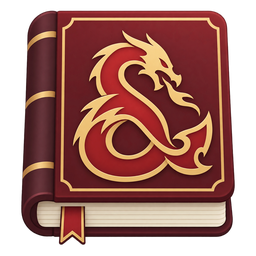
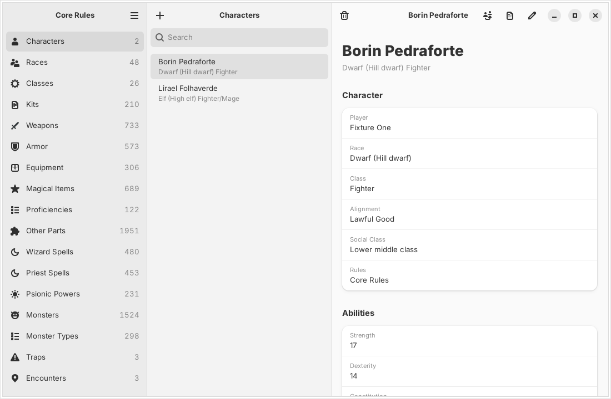
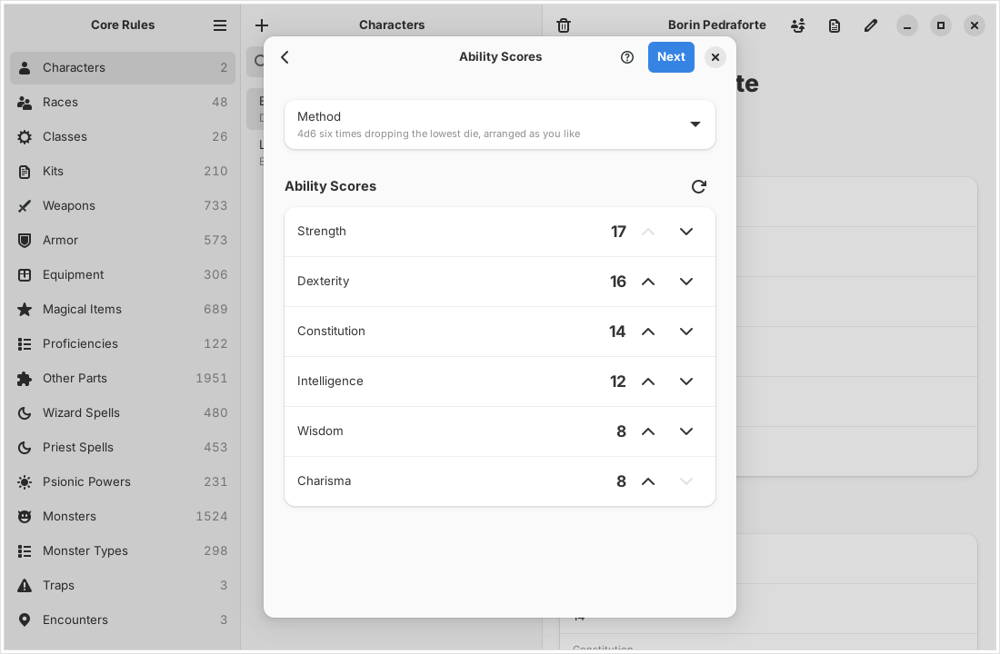
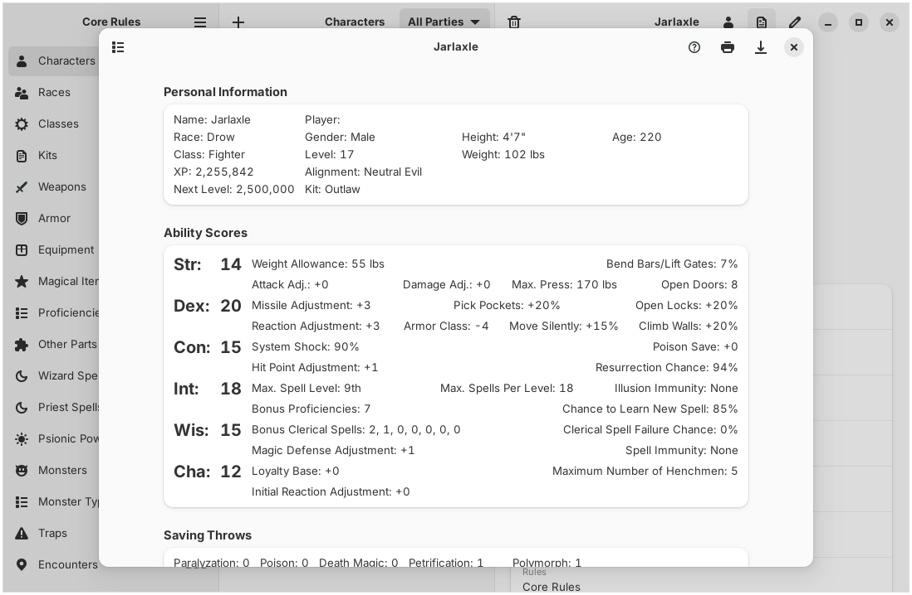
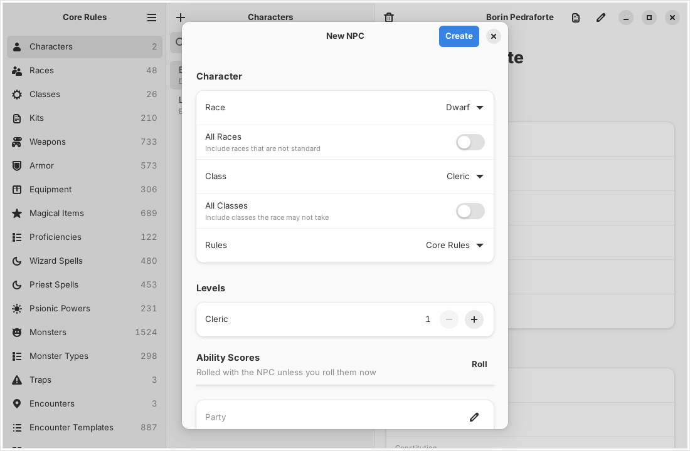
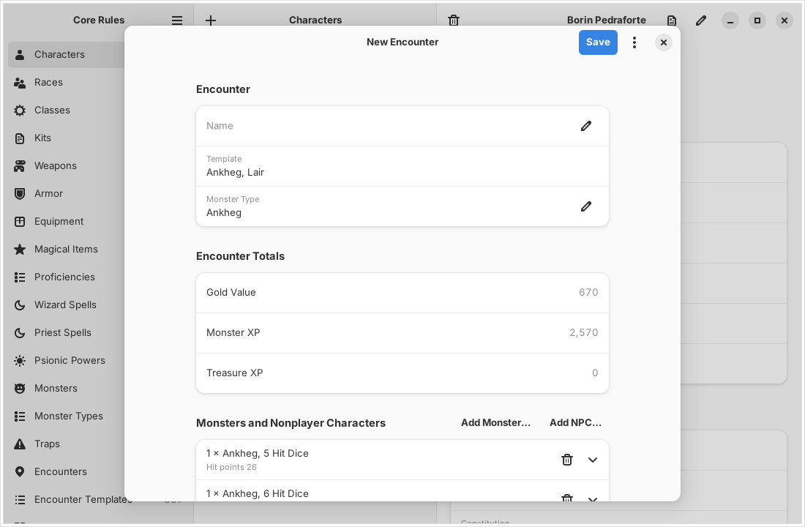
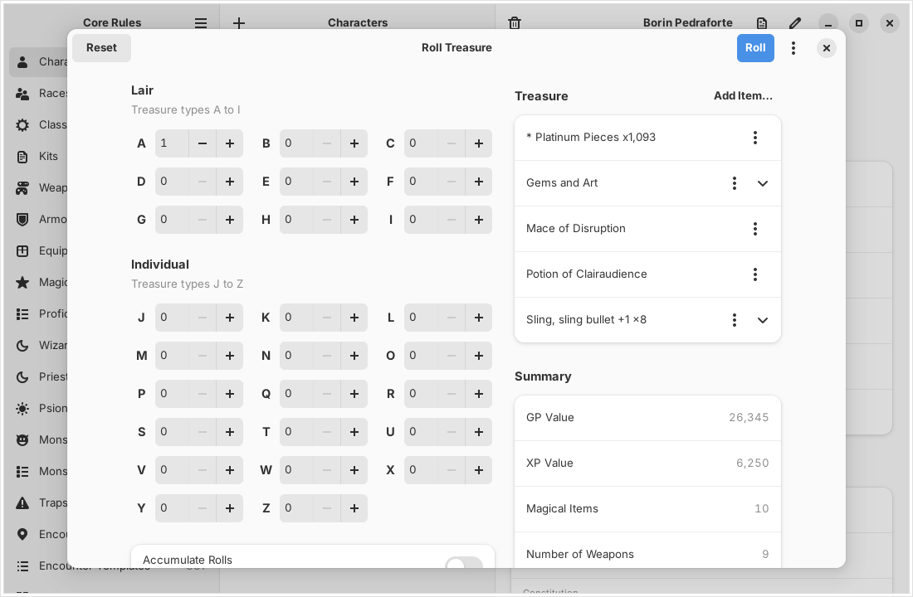
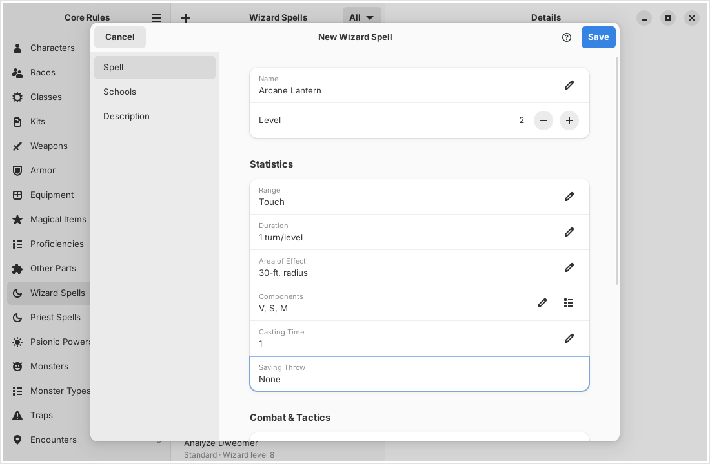
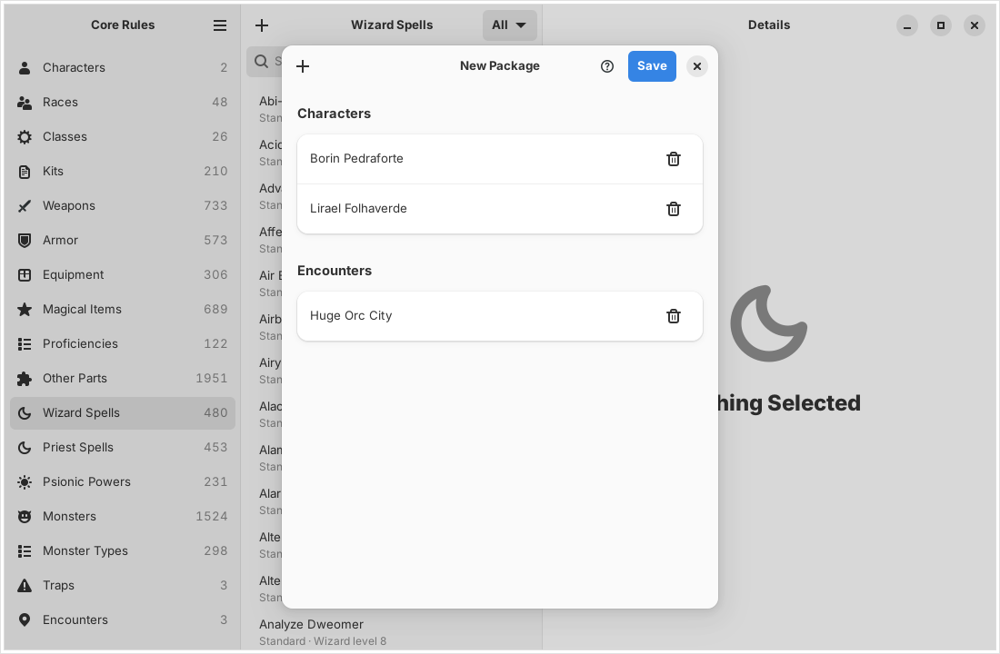
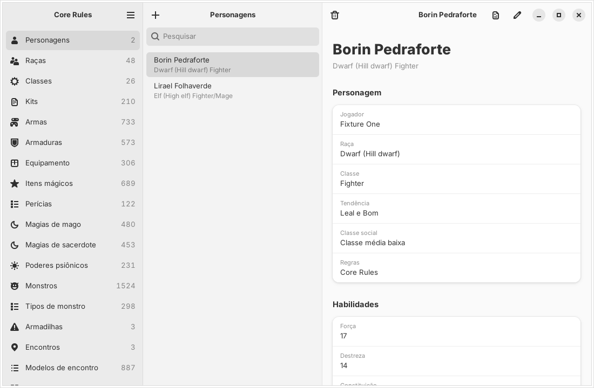

<p align="center">
  
</p>

# Core Rules

A modern Linux replica of **AD&D Core Rules 2.0** (TSR/Evermore, 1998-1999),
written in Rust with GTK4 and libadwaita. It reads and writes the data files
of the original Windows 95 program, so characters made in either program
open in the other.

> **Beta.** Version 0.8.1 is a beta: every feature below works against real
> installations and was checked against the original programs, but it has
> had little use outside those checks. Keep a copy of your `Chars` and
> `UserDbas` folders, and [report](https://github.com/brahm/corerules/issues)
> anything that differs from the original.

> This project contains no TSR or Wizards of the Coast content. It reads the
> rules data from a Core Rules installation you already own.



## Features

Everything the app saves opens in the original programs. Where a feature
says it works as the original does, its results were compared with files
the original programs wrote.

### Library

- Browse the characters, races, classes, items, spells, psionic powers and
  monsters of an installation, of its CD, or of a data package
- **Extract Data from CD…** copies what the app uses from the Core Rules
  2.0 or Expansion CD (its ISO image or the mounted CD) or an installation
  into the app's data folder, so neither the CD nor Wine is needed again
- Weapons, armor, equipment and magical items show their icons, those of
  `Bitmaps/Equip` or the user's own in `UserBMP`, on their pages and in a
  character's equipment
- The Core Rules books in a reader with contents and search
- Lists sort exactly as Windows sorts them (`CompareStringW`, checked under
  Wine)

### Character Generator

- **New Character** (Ctrl+N), following the original wizard: campaign
  setting, ability rolls (Methods I to VI, entered scores or Player's
  Choice), race and subrace, class, details, proficiencies and languages,
  rogue skill points, spells and starting equipment. The original has no
  campaign settings, so each setting only narrows what the installed
  databases offer, following its campaign book
- **Enter Character**, the same wizard for a character that already exists
  on paper, as the original's Enter Character button: scores typed in from
  1 to 25 and kept as typed, exceptional Strength at 18 whatever the class,
  any race and its classes with no minimums, All Classes… for any other
  combination (one class of each group), a free alignment and gender, and
  on the details page each class's level or experience in the Levels
  dialog (prime requisite bonus, level limits, character points per level),
  rolling hit points and PSPs for each level gained, with hit point and PSP
  arrows in place of the rolls. The later pages take what the sheet has:
  racial and class abilities, proficiencies, rogue points and spells of any
  level with no limits or totals checked, the kit's equipment not imposed
- **Kits** in New Character, as the Expansion offers them: only those the
  character's scores, gender, alignment and classes allow, with the
  original's warnings and the kit's information text. The kit's fixed rogue
  skill adjustments, barred class abilities, schools, spells and languages
  are applied when the character is written, and again when an edit is saved.
  The kit's own rogue skill points, its bonus to one skill of a list, the
  skills it has the character choose and its list for the starting points
  (with the original's warning) are on the Rogue Skills page. The schools
  the kit bars are warned about on the Spells page and go unless ignored,
  and a kit limited to five schools has the wizard eliminate the rest, the
  spells offered following the schools kept. The kit's hit points go on
  every hit die roll and its own dice and percentages on the starting
  money. The Equipment page shows the kit's text, the items and the chosen
  weapon it requires, charges the kit's percentage of each price, gives the
  kit's free equipment, weapons and magic items, and warns when more money
  is kept than the kit allows
- **Items a character may not use**: buying one on the Equipment page of
  New Character or of an edit asks first, with the original's message about
  the class, race, class abilities or kit
- **Class and kit proficiencies** in New Character: the required ones go in
  first, bonus, free and kit-recommended ones cost less or nothing, the
  bonus, free, +1 and +2 picks are offered as the Expansion offers them, the
  kit's own starting slots are asked about, and a proficiency the kit bars
  brings the original's warning
- **Kit weapon proficiencies** in New Character: the kit's slots, prices
  and weapon list, the original's warnings for the weapons it bars or
  requires (its sword list, thrown weapons, every other one from a list),
  the nonweapon slots it lets weapons use, its requirements, the weapon to
  focus in, and Core Rules weapon specialization (2 slots for a bow, 1 for
  the others, a free one some kits give) with the original's questions;
  weapons out of class ask first (Core Rules) or cost more (Player's
  Option), as do a cleric's edged weapons and the class abilities that
  limit weapons, and unarmed combat goes to the classes and kits that
  allow it, never together with a weapon specialization
- **Player's Option** (Skills & Powers) creation, as the Expansion's
  Player's Option button: Methods VII to X, racial and class abilities
  bought with character points, subabilities, traits and disadvantages,
  proficiencies with ranks, broad and tight weapon groups (warriors and
  priests, 6 and 4 points, covering their weapons for the kit's checks,
  the specializations and the attack penalty), weapon of choice, expertise
  and specialization, unarmed combat, shield and armor proficiencies,
  fighting styles
- **Portraits**, in New Character and when editing: one of the race's
  portraits or any other in `Bitmaps/Portrait`, or a BMP, JPEG, GIF or PNG
  picture of your own, which the app cuts to the portraits' size and saves
  there as an 8-bit bitmap in the original's palette, so the original shows
  it too
- **Editing** a character: name, player, gender, alignment, kit (which
  rolls the social class again, as Update Character does), social class,
  background event and history, portrait, age, height, weight, hit points
  (moving the rolls as the original's arrows do), ability scores, subrace,
  racial and class abilities, schools and spheres, weapon proficiencies,
  weapon groups, weapon of choice, expertise, specializations, mastery, unarmed combat,
  shields, armor, fighting styles, traits and disadvantages (charging and
  refunding character points as Update Character does, with its questions
  and the kit's weapon warnings, the Core Rules slots left, the kit's free
  weapons at their levels, the kit's focus weapon, and the Cavalier's sword
  at 3rd level and horseman's weapon at 5th), rogue skill points
  at the current level (with the kit's own points, its bonus of each level
  and the skills it has the character choose, none of them spent), psionic disciplines and powers, wild talents and
  psionic attack and defense modes (with Update Character's limits), nonweapon
  proficiencies (ranks, costs as New Character charges them, the kit's free
  ones at their levels, the Core Rules slots left, and the kit's warnings
  and questions), languages, spells known, spellbooks and memorized spells
  (with the kit's barred schools, the schools beyond five to eliminate, the
  spheres to keep, its free sphere and its warning for a kit that never
  uses spells, as Update Character's Spells and Memorize pages ask, and
  the kit's notes on the schools and spheres of the Abilities page), the
  nine equipment groups with quantities (with the kit's text, and the
  original's question about an item the character may not use), and
  Spending Money
- **Experience and levels** per class, all classes or split, with the prime
  requisite bonus, hit point rolls, PSPs, character points and the
  Expansion's racial level limits, and the kit's own experience per level,
  cap on the bonus and hit points per level; **dual-classing** for humans
- **Character sheet**: every section the originals export, shown in the
  app, printed, saved as PDF, or exported as the originals' TXT and HTML,
  matching their exports line for line, or as Markdown (in place of the
  Expansion's RTF); in the Expansion, the sheet's options choose its
  sections, their order and page breaks, and the printed border
- **Parties**: Manage Parties… puts characters in a party, takes them out
  or deletes every member; a character can be deleted, with Undo; the list
  filters by party
- **Convert to NPC** and **Convert to Character** move a character to the
  DM Toolkit's NPCs and back, writing the same files as the Expansion

<p>
  
  
</p>

### DM Toolkit

- **NPC generator** (New NPC, New NPC Group): Core Rules and Player's
  Option NPCs with kits, proficiencies, equipment, spells, psionics and
  rogue skills; with the same seed it saves the same NPCs as the Expansion
- **Treasure generator**: treasure types A to Z, table rolls, intelligent
  weapons, spell scrolls, Calculate and saved bundles; with the same seed
  it saves the same bundles as both originals, byte for byte
- **Encounter generator**: encounters from templates with the originals'
  dice, dependents, items and treasure, the Encounter dialog's editing and
  totals (each monster's hit points set by hand or rolled again with
  Re-roll, and New Monster from Add Monster), saved encounters and the
  2-20 tables
- **Table Rolls** on every table of the books, with the originals' dice
  and follow-up rolls
- **Editors for every user database**: races, classes (with the free
  spells, NWPs and class abilities each level grants, and Auto Fill from
  another class) and allowed combinations, parts (weapons, armor, kits and proficiencies, plus the
  ten other types in Other Parts: racial and class abilities, languages,
  schools, spheres, traits, disadvantages, gems and art, currency and
  Count), spells, psionic powers, monsters (with their spells, their
  inventory in the Treasure Bundle Editor, their attacks, each made or
  changed in the Monster Attack editor the original has but hides, and
  Suggest XP Value), monster
  types, traps, treasure
  tables and encounter templates (monsters, NPCs, items with their coins
  and escorts, traps, treasure types and the 2-20 table, with the
  original's dependents and "and"/"or" second groups). A monster type's picture is chosen among those in
  `Bitmaps/Monsters` and `UserBMP`, a race's among the portraits, or made
  from a picture of your own as portraits are (monster pictures go to
  `UserBMP`, at 300×300). A weapon's, piece of equipment's, magical item's,
  gem's or coin's picture, on General Info, is one of the icons of
  `Bitmaps/Equip`, found by the items that have it, one of yours in
  `UserBMP`, or made from a picture of your own (64×64, in `UserBMP`)
- **Packages**: Export, Import, New Package and Edit Package for `.xpx`
  packages with characters and any user record, byte for byte as the
  Expansion writes them; Core Rules 2.0 `.xpt` packages are imported and
  converted. Monsters travel in these packages (there is no `.mon` file)

<p>
  
  
</p>

<p>
  
  
</p>

<p>
  
</p>

### Core Rules 2.0 and the Expansion

Everything new follows the Expansion (AD&D Core Rules 2.0 Expansion). A Core
Rules 2.0 installation without the Expansion opens read-only: Import Core
Rules 2.0… (or `cr import EXPANSION_DIR CORE_RULES_2.0_DIR`) copies its
characters and records into an Expansion installation, converted the way the
Expansion converts a 2.0 package, and leaves the 2.0 folder untouched.

### Everywhere

- Interface in English (US), Português (Brasil), Español, Italiano,
  Français and Deutsch (see [Languages](#languages))
- Runs without Wine from a data package (see
  [Running without Wine](#running-without-wine))
- The `cr` command does the same from a terminal: `cr chars`, `cr sheet`,
  `cr npc`, `cr treasure`, `cr encounter`, `cr table`, `cr userdb`,
  `cr export`, `cr import`, `cr package`, `cr party`, `cr delete`,
  `cr survey`
- **Help**: the Help button and F1 on every screen open its topic of the
  program help, as the original's Help… buttons do; a right-click on a
  control shows its help, and on a race, class, item, spell, psionic power
  or monster its topic in the book's help (or, for a record of the user
  database, its description), and on a character, trap, encounter,
  template or saved treasure its summary, as the original does; the help
  window and the monster page can print; the Help menu has the
  Online Manual, the Tome of Help (every installed book's help) and About,
  with the original's version, copyright and credits. The installation's
  WinHelp files are read by the app's own help window
- Every file the app reads or writes is specified in
  [`docs/formats`](docs/formats/README.md)

<p>
  
</p>

### Not included

Map Maker II, the Campaign Mapper and the dice roller are out of scope.
Campaign Mapper drawings inside a package are kept but not offered or
imported. Core Rules 1.0 files are not supported. Only Linux is supported
for now; macOS and Windows are postponed.

## Installing

Every [release](https://github.com/brahm/corerules/releases) has
packages for x86-64 Linux:

| System | Package | Install |
| --- | --- | --- |
| Fedora 44 or newer | `.rpm` | `sudo dnf install ./corerules-*.rpm` |
| Ubuntu 26.04 or newer | `.deb` | `sudo apt install ./corerules_*_amd64.deb` |
| Any distribution | `.flatpak` | `flatpak install --user CoreRules-*.flatpak` |
| Any distribution (glibc 2.43+) | `.AppImage` | `chmod +x CoreRules-*.AppImage`, then run it |

The app is called **Core Rules** in the applications menu (`corerules` on
the command line); the `.deb` and `.rpm` also install the `cr` command-line
tool. The Flatpak uses the GNOME 51 runtime from Flathub and may read and
write your home folder, where Wine keeps Core Rules, and CDs under `/media`
and `/run/media`. The AppImage bundles the GNOME 51 libraries (GTK,
libadwaita and the rest).

## Running without Wine

The app needs the rules data of a Core Rules CD you own. Instead of
keeping the CD or Wine around, copy what the app uses into a local data
package once with **Extract Data from CD…** in the main menu (also offered
when the app finds no data). Choose the CD's ISO image, read directly with
no mounting or other tools, or the folder of the mounted CD, of an
installation or of a Wine prefix. The same from the command line:

```sh
cr extract-data add_core_rules_2_expansion.iso   # the CD's ISO image
cr extract-data /media/$USER/EVERMORE            # the mounted CD
cr extract-data "$HOME/.wine"                    # Core Rules installed in Wine
```

The data goes into `~/.local/share/corerules/data`, where the app and `cr`
look first. If that folder is taken, the package goes next to it as
`corerules-data-core20` or `corerules-data-expansion`; the Expansion takes
the data folder over from Core Rules 2.0 data, which moves aside, since the
Expansion is where the app makes and changes things (2.0 content is brought
in with Import Core Rules 2.0…). The package holds TSR/Wizards of the Coast
content: keep it for your own use and do not redistribute it.

## Community add-ons

The [Core Rules Community Add-ons Collection](addons/README.md) gathers 672
add-ons the community made for Core Rules 2.0 and the Expansion (races,
classes, kits, spells, monsters, modules and the AD&D Core Rules User
Database), converted to the Expansion's format and consolidated into
36,525 items, with the 668 pictures that came with them. Monster types,
monsters, races and characters show those pictures in the app. It ships as its own self-installing AppImage
(`crates/cr-addons`, GTK 4 and libadwaita), published on GitHub Packages as
[`corerules-community-addons`](https://github.com/brahm/corerules/pkgs/container/corerules-community-addons),
and needs the app 0.7.2 or newer. The installer finds the app on its own,
whether it came as the Flatpak, the .deb or .rpm package or an AppImage,
and speaks the app's six languages. Its [README](addons/README.md) says
what is inside, how it was built and how to install it.

## Testing against your own installation

The rules databases are copyrighted and are not part of this repository.
To check the readers against them, point `CORERULES_DIR` at an installed
copy (the folder that holds `Database/`):

```sh
CORERULES_DIR="$HOME/.wine/drive_c/Program Files/AD&D Core Rules 2.0" cargo test
```

## Layout

| Crate | Purpose |
| --- | --- |
| `cr-formats` | Readers and writers for the original file formats, no UI |
| `cr-store` | Finds and opens an installation (case-insensitive paths) and builds the catalog the app shows |
| `cr-cli` | `cr` command for inspecting data |
| `cr-i18n` | Translations of the interface (`po/*.po`, built into the program) |
| `cr-gtk` | The GNOME app |
| `cr-addons` | Core Rules Community Add-ons Collection, the add-ons and their installer |

The backend crates have no GTK dependency so macOS and Windows front ends
can reuse them later.

## Languages

The app speaks the system's language when it is one of English (US),
Português (Brasil), Español, Italiano, Français or Deutsch, and English
otherwise. Preferences (Ctrl+,) can choose another language; the choice is
kept in `~/.config/corerules/settings.ini` and applies the next time the app
starts. Only the interface is translated: spell, monster, item and class
names and texts from the original files stay as they are, and so do the
`cr` command, exports and character sheets.

Texts are wrapped where they are written (`tr("Save")`,
`tr!("Deleted {name}", name)`, `trn!("{n} entry", "{n} entries", count)`).
`cargo test` fails while a wrapped text lacks a translation in any
language; after adding or changing texts, run

```sh
cargo run -p cr-i18n --example update-po
```

to update `crates/cr-i18n/po/corerules.pot` and add the new entries to every
catalog, then translate them in each `.po`.

## Building

You need Rust 1.88 or newer, GTK 4.14 or newer and libadwaita 1.5 or newer.

On Fedora 44 or newer:

```sh
sudo dnf install cargo rust gcc gtk4-devel libadwaita-devel
cargo build --release
cargo test
./target/release/corerules
```

On Ubuntu 24.04 or newer (its packaged Rust is too old, so use
[rustup](https://rustup.rs)):

```sh
sudo apt install build-essential libgtk-4-dev libadwaita-1-dev
cargo build --release
cargo test
```

To install a build system-wide, run `packaging/install.sh / /usr/local`
as root after `cargo build --release`.

### Packages

`packaging/` builds every package (the `.rpm` and Flatpak compile from source,
the others package `target/release`):

```sh
packaging/deb/build.sh 0.1.0        # dist/corerules_0.1.0_amd64.deb (on Ubuntu 26.04)
packaging/rpm/build.sh 0.1.0        # dist/corerules-0.1.0-1.fc44.x86_64.rpm (on Fedora 44, needs rpm-build)
packaging/appimage/build-in-sdk.sh 0.1.0  # dist/CoreRules-0.1.0-x86_64.AppImage (in the GNOME 51 SDK)
flatpak-builder --user --install-deps-from=flathub --install build \
    packaging/flatpak/io.github.brahm.CoreRules.yml
```

The Packages workflow in GitHub Actions builds all four, installs each one
on clean Ubuntu 26.04, Ubuntu latest, Fedora 44 and Fedora latest
containers and starts the app there once in each of its six languages,
checking that every text on screen is in that language
(`packaging/smoke-test.sh`). Pushing a `v*` tag, or running the workflow
with a tag, publishes them as a release; `packaging/release-notes.md` is its
description. Releases before 1.0 are published as betas.

## Using an original installation

Install Core Rules 2.0 (and the Expansion) with Wine. The tools look in
`$WINEPREFIX/drive_c/Program Files/AD&D Core Rules 2.0`, or take a folder:

```sh
cargo run -p cr-cli -- chars
cargo run -p cr-cli -- survey "/path/to/AD&D Core Rules 2.0"
cargo run -p cr-gtk                                # the Wine prefix
cargo run -p cr-gtk -- "/media/cdrom"               # or any folder with Database/
```

## License

MIT, see [LICENSE](LICENSE). AD&D and Advanced Dungeons & Dragons are
trademarks of Wizards of the Coast; this project is not affiliated with them.
