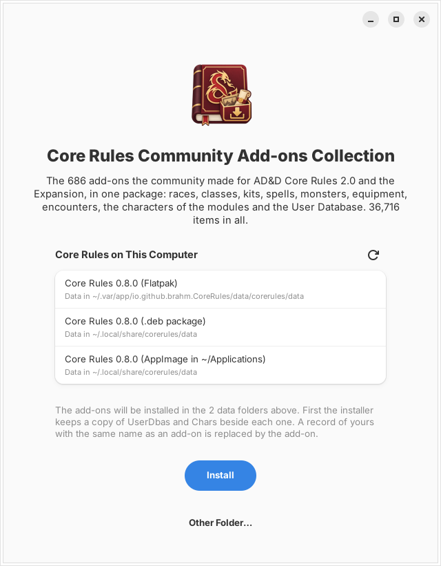
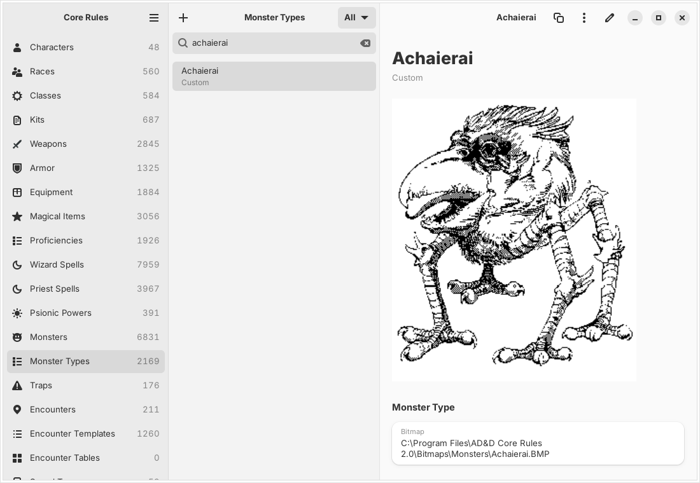
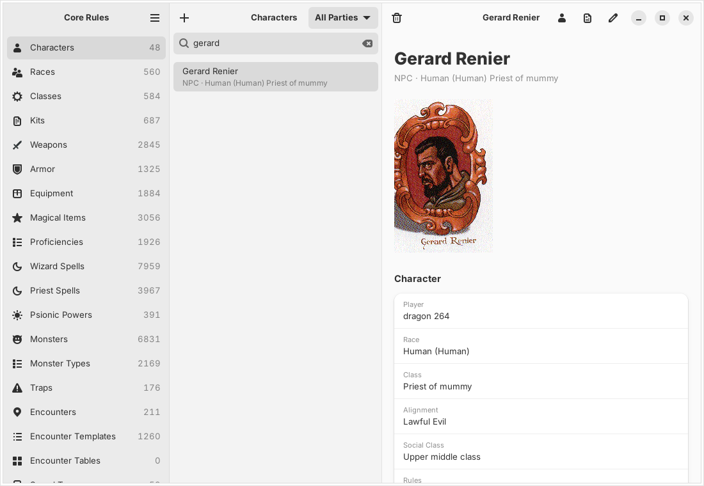
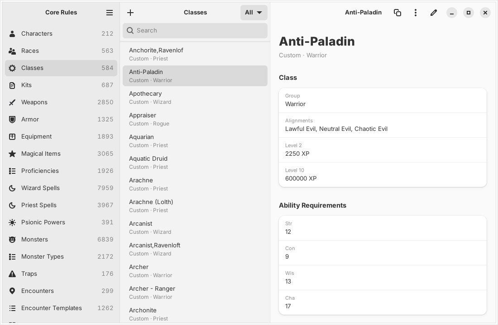
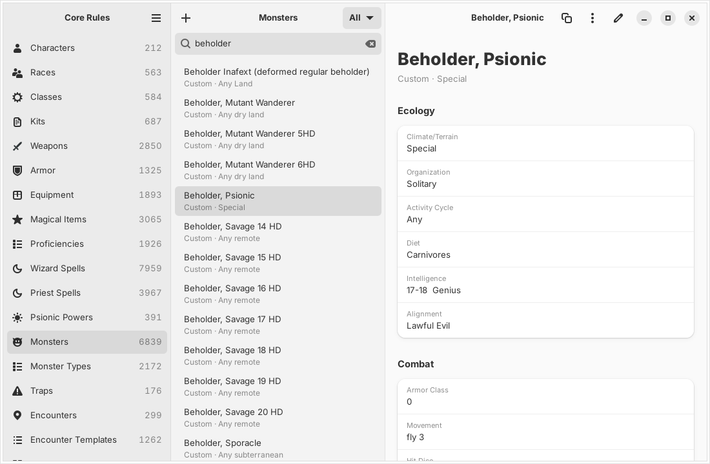
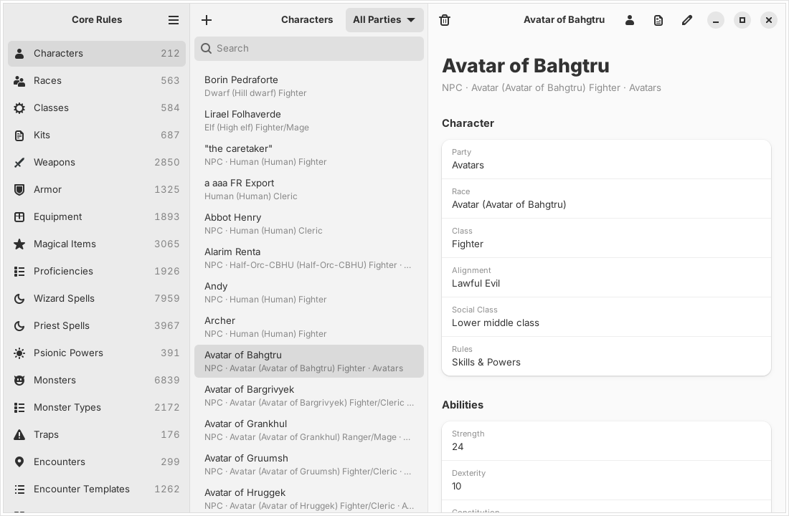
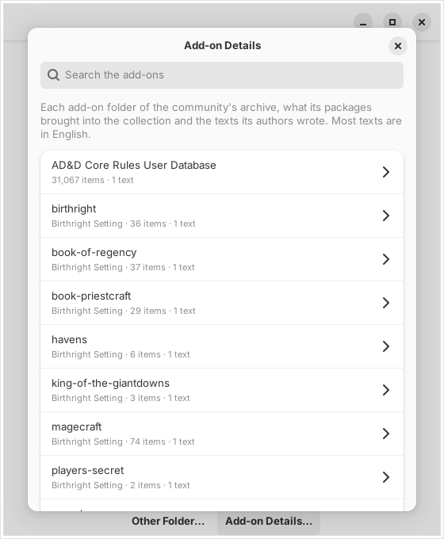
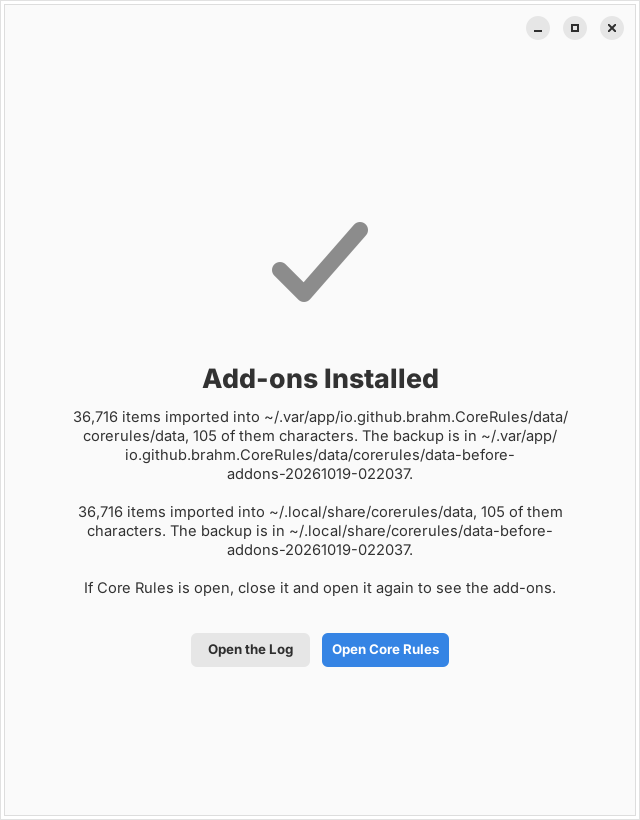

<p align="center">
  
</p>

# Core Rules Community Add-ons Collection

The add-ons that the AD&D Core Rules community made for **AD&D Core Rules 2.0** and its **Expansion**, gathered into one
package and installed with one click into [Core Rules](../README.md), the
Linux replica of the original program. 672 add-on packages became 36,525
items: new races and classes, kits, thousands of spells and monsters,
equipment, encounters, the characters of the published modules and the
AD&D Core Rules User Database. The 668 pictures that came with them are
installed too, and the texts their authors wrote can be read in the
installer.

> The collection holds what the community wrote and shared as add-ons. It
> leaves out the monthly goodies that Evermore Entertainment, the company
> that made Core Rules 2.0, published in 1998–2000, and the copies of them
> in the User Database. The rules data still comes from a Core Rules
> installation you already own.



## What's inside

Every item is in the Expansion's own format, so it opens in the app and in
the original program alike.

| Kind | Items |
| --- | ---: |
| Wizard spells | 7,479 |
| Priest spells | 3,514 |
| Monsters | 5,307 |
| Monster types | 1,871 |
| Magical items | 2,367 |
| Weapons | 2,112 |
| Equipment | 1,578 |
| Armor | 752 |
| Races | 512 |
| Classes | 558 |
| Kits | 477 |
| Racial and class abilities | 5,449 |
| Nonweapon proficiencies | 1,804 |
| Languages | 672 |
| Encounters and encounter templates | 584 |
| Traps | 173 |
| Psionic powers | 160 |
| Traits and disadvantages | 253 |
| Spheres and schools of magic | 362 |
| Treasure bundles, gems, art and currencies | 336 |
| Characters from the modules | 48 |
| Other parts | 157 |

Once installed, the add-ons sit in the user databases next to your own
records, and the module characters join the character list. Monster types,
races and characters show the picture their author drew or scanned, in the
app and in the original program.

<p>
  
  
</p>

<p>
  
  
</p>



## Installing

The collection is a single AppImage, `CoreRules-Community-Addons-VERSION-x86_64.AppImage`,
that carries the add-ons inside and installs them itself. It needs:

* Linux x86-64 with glibc 2.43 or newer (Fedora 44, Ubuntu 26.04 or newer)
* [Core Rules](https://github.com/brahm/corerules/releases) 0.7.2 or newer,
  as the Flatpak, the .deb or .rpm package or the AppImage
* Your Expansion data in the app; if it is not there yet, open Core Rules
  and use **Extract Data from CD…**

It is published on GitHub Packages as
[`corerules-community-addons`](https://github.com/brahm/corerules/pkgs/container/corerules-community-addons),
an OCI artifact rather than a container image, so `docker pull` does not
apply. Download it with [ORAS](https://oras.land):

```sh
oras pull ghcr.io/brahm/corerules-community-addons:latest
chmod +x CoreRules-Community-Addons-*-x86_64.AppImage
./CoreRules-Community-Addons-*-x86_64.AppImage
```

The [Portuguese guide](GUIA.md) also shows how to download it with
`curl` alone, and how to undo an install.

The window looks for Core Rules on its own and lists every copy it finds
with the data folder that copy reads:

| How the app was installed | Data folder |
| --- | --- |
| Flatpak | `~/.var/app/io.github.brahm.CoreRules/data/corerules/data` |
| .deb or .rpm package | `~/.local/share/corerules/data` |
| AppImage in Downloads, Applications, Desktop, `~/.local/bin`, `/opt` or the home folder | `~/.local/share/corerules/data` |

Without that folder, a copy falls back to the original program in the Wine
prefix, as the app does. **Install** copies `UserDbas` and `Chars` to a
backup beside each folder, then imports the add-ons, in under a minute per
folder. It also copies the pictures to where the records look for them
(`Bitmaps/Monsters`, `Bitmaps/Portrait` and `UserBMP` in the data folder,
and the folders on drive C: that the records name, inside Wine), never over
a file that is already there. **Other Folder…** is there for an
installation it does not find, and **Add-on Details…** lists every add-on
folder with what it brought into the collection and its authors' texts.





The installer speaks the app's six languages (English, Português (Brasil),
Español, Italiano, Français and Deutsch) and follows the one chosen in
Core Rules' Preferences, or the system's.


## How it was built

**Testing every add-on.** The community's archive held 686 packages: 492
Expansion `.xpx` files and 194 Core Rules 2.0 `.xpt` files, including the
AD&D Core Rules User Database. 14 of them were Evermore's monthly goodies,
which the collection leaves out. Each one was read and written back byte for
byte by this project's reader, and the doubtful ones were imported into the
original Expansion program under Wine.

**Converting and repairing.** 90 packages, made with the Expansion after
patches 3 to 5, were refused by the CD's program. Their classes lost the
spell point objects the CD's version does not know, and the User
Database's kits were rewritten in the older kit format. A spell package
damaged by a text-mode transfer had its line endings and lengths restored,
and 103 kits were recovered from a truncated archive. One package held only
a web installer and could not be used. Map Maker II maps and Campaign
Mapper drawings were left out, since the app does not handle those
programs.

**Consolidating.** The packages were imported into a clean Expansion
installation from oldest to newest, the User Database last, and exported
as one file, `Comunidade.xpx`. Where a name appears in more than one
add-on, the newest version wins, as in the original Import; the
[report](relatorio.md) lists every conflict and every package's status.

**Checking in the app.** After an install, every add-on record was opened,
edited and saved with the app's own editors and read back, and none
failed.

**Packaging.** The consolidated file is compressed with xz and built into
the installer, `crates/cr-addons`, a Rust program with GTK 4 and
libadwaita that imports it through the same code as the app (`cr-store`),
in two passes so race and class combinations that name two new classes
come in.

**Pictures and texts.** The 668 pictures (8-bit BMP files) and 309 texts
that came with the add-ons, again without Evermore's, are built into the
installer as `Comunidade-extras.xz`. Each picture goes to the place the
records name: a record stores the Windows path the picture had on its
author's computer (`C:\Program Files\AD&D Core Rules 2.0\Bitmaps\Monsters\
Achaierai.BMP`, `C:\AD&D Pics\troll.bmp`), and the app maps that path into
the data folder the same way (`cr-store`'s `pictures` module). The texts,
readme files in plain text, HTML, RTF, Word and PDF, were converted to plain
text. `packaging/appimage/build-in-sdk.sh VERSION addons` builds the
AppImage in the GNOME 51 SDK, and the `Addons package` workflow
(`.github/workflows/addons.yml`) publishes it on GitHub Packages on every
change to `main`.

## Files

| File | Contents |
| --- | --- |
| `Comunidade.xpx.xz` | The consolidated add-ons, as built into the installer |
| `Comunidade-extras.xz` | The add-ons' pictures and texts, and where each picture goes |
| `tools/` | The scripts that chose each picture's place and built `Comunidade-extras.xz` |
| [`relatorio.md`](relatorio.md) | The report, in Portuguese: what was converted, repaired or left out |
| [`compatibilidade.csv`](compatibilidade.csv) | One line per add-on package, with its status and item count |
| [`conflitos.csv`](conflitos.csv) | The names found in more than one package, and which version stayed |
| [`GUIA.md`](GUIA.md) | The install guide, in Portuguese |

The add-ons belong to their authors in the Core Rules community.
